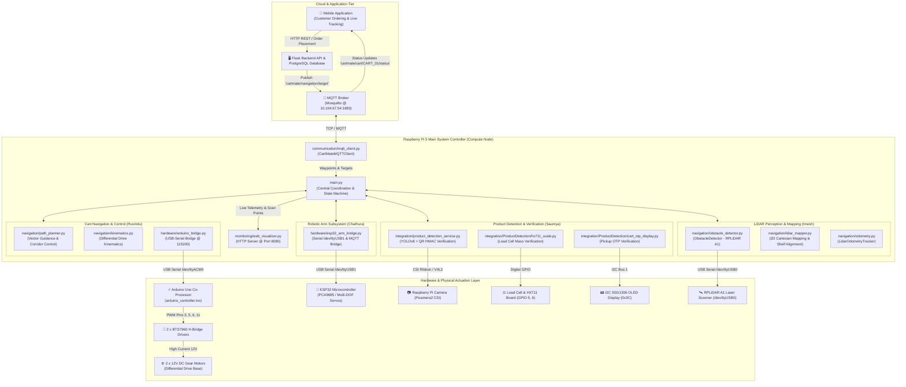
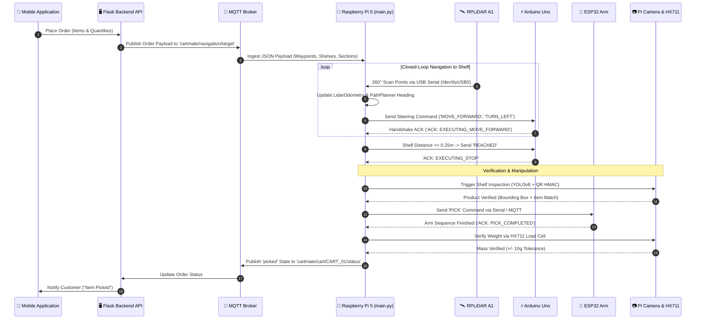
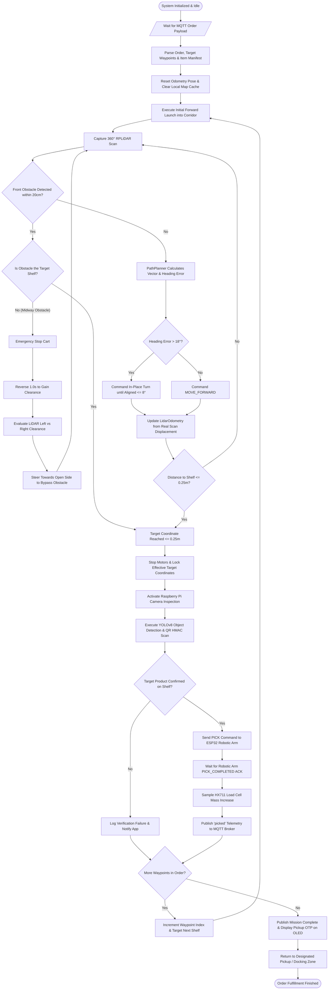

# CartMate: Autonomous Smart Retail Cart System

[-c51a4a.svg?style=flat-square&logo=raspberry-pi)](https://www.raspberrypi.com/)
[](https://www.python.org/)
[](https://www.arduino.cc/)
[](https://ultralytics.com/)
[]()

---

## 1. Project Title
**CartMate – Autonomous Smart Retail Cart System for Frictionless Supermarket Fulfillment**

---

## 2. Project Overview
**CartMate** is an autonomous, intelligent mobile retail shopping cart designed to modernize the in-store supermarket shopping experience and automate order fulfillment. Operating on an onboard **Raspberry Pi 5** computation unit, CartMate accepts customer purchase requests generated via a dedicated mobile application, resolves shelf destinations within the retail environment, navigates aisles autonomously using laser rangefinder guidance, collects requested merchandise with a multi-DOF robotic manipulator, inspects and verifies products using multi-modal computer vision and mass telemetry, and coordinates with a central supermarket enterprise backend.

The system addresses critical challenges in retail automation, including indoor navigation without GPS, real-time obstacle avoidance in dynamic customer environments, precision shelf alignment, reliable pick-and-place manipulation, and anti-theft product verification.

---

## 3. Research Project Objectives
1. **Autonomous Guided Navigation:** Implement a robust closed-loop navigation engine for differential-drive mobile bases operating within narrow retail corridors without reliance on external beacons.
2. **Real-Time Environmental Perception & Mapping:** Utilize 2D planar LiDAR for real-time corridor bounding, dynamic midway obstacle detection, obstacle avoidance, and physical shelf surface alignment.
3. **Multi-Modal Product Verification:** Implement a dual-stage verification framework pairing YOLOv8 deep-learning object identification with cryptographic HMAC-SHA256 QR code scanning and strain-gauge weight measurement.
4. **Automated Robotic Product Collection:** Coordinate an articulated robotic arm to pick designated merchandise from supermarket shelves upon physical cart arrival.
5. **Distributed IoT Integration:** Establish low-latency asynchronous telemetry, command dispatch, and mission synchronization across a mobile application, central database, and robotic cart via MQTT and REST protocols.

---

## 4. Key Features
- **Real-Time Closed-Loop Navigation:** Vector-based dynamic steering (`MOVE_FORWARD`, `TURN_LEFT`, `TURN_RIGHT`) maintaining heading alignment with corridor-bounded trajectory tracking.
- **RPLiDAR A1 360° Environmental Mapping:** Real-time 2D Cartesian transformation, multi-revolution voxel-grid deduplication, and physical shelf target snapping (`align_shelf_target`).
- **Obstacle Detection & Bypass Recovery:** 20 cm safety envelope with differentiated logic for destination shelf arrival versus midway aisle blockages, executing automated reverse-and-steer bypass routines.
- **LiDAR Odometry Displacement Tracking:** Clock-independent physical motion integration eliminating false coordinate creep and dead-reckoning drift when stationary.
- **Dual-Stage Vision Inspection:** Raspberry Pi Camera CSI pipeline executing YOLOv8 model inference alongside cryptographically signed QR code validation.
- **Load Cell Mass Verification:** Integrated HX711 strain-gauge scale evaluating product mass against item master data to prevent fulfillment errors and shrinkage.
- **Live Interactive Telemetry HUD:** Built-in web visualizer on port 8080 providing live 2D LiDAR point clouds, cart heading vectors, waypoints, and navigation cockpit telemetry for remote supervision.
- **Secure Customer Pickup Authentication:** Dynamic OTP generation and display on cart OLED display matched with customer mobile application at order handoff.

---

## 5. Complete System Architecture



---

## 6. Team Members and Responsibilities

The CartMate project is developed by four technical contributors, each leading a core subsystem:

| Member | Architectural Component | Primary Hardware Domain | Key Software Modules |
| :--- | :--- | :--- | :--- |
| **Ruvindu** | **Cart Navigation & Control** | Arduino Uno, BTS7960 Drivers, 12V DC Motors, Wheel Encoders | `hardware/arduino_bridge.py`, `hardware/arduino_controller/`, `navigation/path_planner.py`, `navigation/kinematics.py`, `communication/serial_bridge.py`, `hardware/teleop_test.py` |
| **Imesh** | **LiDAR Mapping & Localization** | Slamtec RPLiDAR A1 360° Laser Scanner | `navigation/obstacle_detector.py`, `navigation/lidar_mapper.py`, `navigation/odometry.py` (`LidarOdometryTracker`), `rplidar.py`, `hardware/rplidar_test.py` |
| **Chathura** | **Robotic Arm System** | ESP32 Controller, PCA9685 I2C Driver, Articulated Servo Motors | `hardware/esp32_arm_bridge.py`, `integration/arm_interface.py` |
| **Saumya** | **Product Detection & Verification** | Raspberry Pi Camera (Picamera2), Load Cells, HX711, SSD1306 OLED | `integration/product_detection_service.py`, `integration/ProductDetection/` (`pick_command.py`, `qr_scan.py`, `hx711_scale.py`, `app_bridge.py`, `cart_otp_display.py`, `backend_api.py`) |

### Detailed Technical Breakdown

#### 1. Ruvindu – Cart Navigation & Control
- **Low-Level Motor Control:** Differential drive control of two 12V DC geared motors powered by dual BTS7960 H-bridges with PWM generation (Pins 5, 6 for Left motor; Pins 3, 11 for Right motor).
- **Embedded Firmware:** Developed `arduino_controller.ino` with high-frequency command interpreter (`MOVE_FORWARD`, `MOVE_BACKWARD`, `TURN_LEFT`, `TURN_RIGHT`, `EMERGENCY_STOP`), hardware watchdog safety timer (1500 ms auto-shutdown), polarity inversion handling, and deadband switching (25 ms).
- **Serial Protocol Communication:** Robust USB Serial bridge (`hardware/arduino_bridge.py`) with automatic baud rate negotiation and auto-port detection across `/dev/ttyACM*` and `/dev/ttyUSB*`.
- **Differential Kinematics:** Mathematical conversion between twist coordinates $(v, \omega)$ and individual wheel RPM targets (`navigation/kinematics.py`).
- **Closed-Loop Path Guidance:** Real-time heading error calculation with corridor bounding (restricting maximum heading angle to $\pm 15^\circ$ inside aisles) and hysteresis steering control to eliminate oscillatory motor jitter (`navigation/path_planner.py`).
- **Interactive Teleoperation:** Teleoperation console (`hardware/teleop_test.py`) for raw motor validation, directional testing, and diagnostic calibration.

#### 2. Imesh – LiDAR Mapping & Localization
- **Sensor Integration:** Direct hardware communication with the RPLiDAR A1 over USB serial (`/dev/ttyUSB0`), including an upstream patch for packet recovery and descriptor desynchronization handling.
- **Environmental Scanning Engine:** Persistent threaded scanner (`navigation/obstacle_detector.py`) capturing full 360° planar point clouds.
- **2D Cartesian Mapping:** Polar-to-Cartesian transformation converting range measurements $(r, \phi)$ to robot and global world coordinates $(x, y)$, multi-scan rolling persistence, and 5 cm voxel-grid deduplication (`navigation/lidar_mapper.py`).
- **Real-Time Shelf Alignment:** Clustering algorithms (`align_shelf_target`) searching within a 0.75 m radius of navigation waypoints to snap target coordinates onto physical shelf surfaces.
- **Zero-Drift Motion Odometry:** `LidarOdometryTracker` calculating physical translation based on front/rear/lateral sector median differences, ensuring zero coordinate drift when the robot is stationary.
- **Front Corridor Safety Guard:** Frontal safety envelope ($\pm 32$ cm lateral corridor width) tuned to chassis geometry (38 cm track width), preventing false obstacle stops from side shelves.
- **Obstacle Classification & Directional Bypassing:** Distinguishes between destination shelf obstacles and midway aisle blockages; calculates sector clearances (`get_sector_clearances`) to command autonomous avoidance maneuvers.

#### 3. Chathura – Robotic Arm System
- **Robotic Arm Mechanical & Electrical Architecture:** Articulated multi-axis robotic arm engineered for retail shelf item grasping and basket placement.
- **Microcontroller Integration:** Controlled via an ESP32 microcontroller linked to the Raspberry Pi 5 over USB Serial (`/dev/ttyUSB1`) and wireless MQTT fallback (`cartmate/arm/pick`).
- **Communication Protocol & Port Isolation:** `hardware/esp32_arm_bridge.py` featuring port-locking logic that strictly prevents probing or hijacking ports reserved for the LiDAR (`/dev/ttyUSB0`) or Arduino (`/dev/ttyACM0`).
- **Command Dispatch:** Formats JSON pick commands (`cmd: PICK`, `product`, `shelf_id`, `section`, `timestamp`) and plain-text fallback strings (`PICK:<product>`), monitoring execution until `PICK_COMPLETED` acknowledgment or timeout (8.0 s).
- **Coordination with Vision:** Automated pick trigger initiated once the computer vision system confirms product presence and section alignment.

#### 4. Saumya – Product Detection & Verification
- **Perception Pipeline:** Raspberry Pi Camera Module 3 / V4L2 webcam pipeline using CSI `picamera2` configuration (`integration/product_detection_service.py`).
- **Deep Learning Object Detection:** YOLOv8 neural network inference (`best.pt`, `yolov8n.pt`) identifying designated retail merchandise (cube, tall box, cylinder, triangle prism).
- **Cryptographic QR Code Validation:** OpenCV QR detection coupled with HMAC-SHA256 signature verification (`<unit_id>|<signature>`) against product ledger parameters (`PRODUCTS` database).
- **Two-Step Verification Policy:** Temporal stability filtering requiring target match and positional stability across $N$ consecutive frames before confirming item readiness.
- **Mass Telemetry Verification:** Hardware driver for HX711 24-bit ADC load cell amplifier (`integration/ProductDetection/hx711_scale.py`) using `gpiozero` on GPIO 5 (DT) and GPIO 6 (SCK), supporting tare, live mass readout, and noise analysis.
- **Fulfillment & Customer Checkout Security:** OTP display engine (`integration/ProductDetection/cart_otp_display.py`) presenting customer collection tokens on an I2C OLED screen and communicating with the central backend API.

---

## 7. Software Architecture

```mermaid
graph TD
    subgraph Core_Runtime["Main System Runtime (main.py)"]
        Main["main.py Event Loop (10 Hz)"]
        StateEngine["Navigation & Task State Machine"]
        Main --> StateEngine
    end

    subgraph Communication_Layer["Communication Layer"]
        MQTTNode["CartMateMQTTClient<br/>(communication/mqtt_client.py)"]
        WebVis["WebVisualizer<br/>(monitoring/web_visualizer.py)"]
        HTTPBackend["Backend API Client<br/>(integration/ProductDetection/backend_api.py)"]
    end

    subgraph Navigation_and_Perception["Navigation & Perception Layer"]
        ObsDet["ObstacleDetector<br/>(navigation/obstacle_detector.py)"]
        LidarMap["LidarMapper<br/>(navigation/lidar_mapper.py)"]
        LidarOdom["LidarOdometryTracker<br/>(navigation/odometry.py)"]
        PathPlan["PathPlanner<br/>(navigation/path_planner.py)"]
        DiffKin["DifferentialKinematics<br/>(navigation/kinematics.py)"]
    end

    subgraph Hardware_Bridge_Layer["Hardware Abstraction Layer"]
        ArdBridge["ArduinoBridge<br/>(hardware/arduino_bridge.py)"]
        ArmBridge["ESP32ArmBridge<br/>(hardware/esp32_arm_bridge.py)"]
    end

    subgraph Inspection_Layer["Vision & Verification Layer"]
        ProdDet["ProductDetector<br/>(integration/product_detection_service.py)"]
        PickCmd["PickDecider / YOLOv8<br/>(integration/ProductDetection/pick_command.py)"]
        HX711["Scale / HX711<br/>(integration/ProductDetection/hx711_scale.py)"]
    end

    MQTTNode -->|Waypoints: x, y, shelf, section| StateEngine
    StateEngine -->|Query 360° Scan| ObsDet
    ObsDet -->|Point Cloud| LidarMap
    ObsDet -->|Front Obstacle & Sector Clearance| StateEngine
    ObsDet -->|Scan Differencing| LidarOdom
    LidarOdom -->|Pose: x, y, theta| StateEngine
    StateEngine -->|Target Vector & Pose| PathPlan
    PathPlan -->|Steering Action| StateEngine
    StateEngine -->|Command: MOVE_FORWARD, TURN_LEFT, etc.| ArdBridge
    StateEngine -->|Shelf Arrival Event| ProdDet
    ProdDet -->|Target Matched Event| ArmBridge
    ProdDet -->|Mass / QR Verification| StateEngine
    StateEngine -->|Telemetry Stream| WebVis
    StateEngine -->|Fulfillment Status| MQTTNode
```



### Module Responsibilities and Data Flow
- **`main.py`:** Central coordinator. Instantiates subsystem bridges, executes the 10 Hz control loop, manages state transitions (`WAITING_FOR_WAYPOINTS` $\to$ `INITIAL_LAUNCH` $\to$ `NAVIGATION` $\to$ `OBSTACLE_AVOIDANCE` $\to$ `REACHED` $\to$ `CAMERA_INSPECTION` $\to$ `ARM_PICK` $\to$ `NEXT_WAYPOINT`), updates telemetry, and coordinates clean shutdown.
- **`config.py`:** Centralized system parameters including physical chassis geometry (`WHEEL_RADIUS = 0.065 m`, `TRACK_WIDTH = 0.380 m`), safety thresholds (`ULTRASONIC_STOP_DIST_CM = 20.0`), velocity limits, and network endpoints.
- **`communication/mqtt_client.py`:** Non-blocking Paho MQTT client subscribing to order dispatches and parsing structured waypoint lists containing shelf IDs, target coordinates $(x, y, \theta)$, and item manifests.
- **`monitoring/web_visualizer.py`:** Multi-threaded native HTTP server running on port 8080 rendering a live WebGL/Canvas HUD displaying real-time LiDAR point clouds, the robot footprint, heading vectors, waypoint markers, and live decision logs.

---

## 8. Hardware Architecture

```mermaid
graph LR
    subgraph Power_System["Power Distribution Subsystem"]
        Battery["12V High-Capacity Li-Ion Battery"]
        Buck5V["5V / 5A Step-Down Buck Converter"]
        Battery -->|12V Raw Rail| BTS7960_HW["BTS7960 Motor Drivers"]
        Battery -->|12V Raw Rail| Buck5V
        Buck5V -->|5V USB-C PD| RPi5["Raspberry Pi 5 (4GB)"]
    end

    subgraph Pi5_Interfaces["Raspberry Pi 5 Main Controller"]
        RPi5 --- USB0["USB 2.0 Port (/dev/ttyUSB0)"]
        RPi5 --- USB1["USB 3.0 Port (/dev/ttyACM0)"]
        RPi5 --- USB2["USB 2.0 Port (/dev/ttyUSB1)"]
        RPi5 --- CSI["CSI-2 Camera Port"]
        RPi5 --- GPIO["40-Pin GPIO Header"]
        RPi5 --- I2C["I2C Bus 1 (GPIO 2, 3)"]
    end

    subgraph Actuators_and_Sensors["Connected Peripherals"]
        USB0 <-->|115200 Baud UART| RPLidar_HW["Slamtec RPLiDAR A1"]
        USB1 <-->|115200 Baud UART| Arduino_HW["Arduino Uno"]
        USB2 <-->|115200 Baud UART| ESP32_HW["ESP32 Robotic Arm Controller"]
        CSI <-->|MIPI CSI-2| PiCam_HW["Raspberry Pi Camera Module 3"]
        GPIO ---|GPIO 5 (DT), GPIO 6 (SCK)| HX711_HW["HX711 ADC + Load Cell"]
        I2C ---|Address 0x3C| OLED_HW["SSD1306 0.96 inch OLED"]
        
        Arduino_HW -->|Pins 5,6 (L_PWM, R_PWM)| BTS7960_HW
        Arduino_HW -->|Pins 3,11 (L_PWM, R_PWM)| BTS7960_HW
        BTS7960_HW -->|M+, M-| MotorL["Left 12V DC Gear Motor"]
        BTS7960_HW -->|M+, M-| MotorR["Right 12V DC Gear Motor"]
        ESP32_HW -->|PWM Control| Servos["Robotic Arm Servos"]
    end
```

---

## 9. Hardware Components

| Hardware Component | Functional Purpose | Software Controller | Hardware Interface | Operational Role |
| :--- | :--- | :--- | :--- | :--- |
| **Raspberry Pi 5 (4GB RAM)** | Main Computation & High-Level Orchestrator | `main.py`, Linux OS | Direct Board Platform | Runs perception, planning, vision inference, web visualization, and communication tasks. |
| **Slamtec RPLiDAR A1** | 360° 2D Laser Distance Measurement | `navigation/obstacle_detector.py` | USB-to-UART Serial (`/dev/ttyUSB0`) | Provides 360° point clouds up to 8m for collision detection, mapping, and shelf alignment. |
| **Arduino Uno** | Real-Time Motor Actuation Co-Processor | `hardware/arduino_bridge.py`, `arduino_controller.ino` | USB Serial (`/dev/ttyACM0`) | Generates PWM signals for motor drivers, monitors watchdog timer, and executes stop commands. |
| **BTS7960 High-Power Drivers (x2)** | Dual Half-Bridge Motor Amplification | `arduino_controller.ino` | Arduino Digital PWM Pins (~5, ~6, ~3, ~11) | Drives high-current 12V DC motors with forward/reverse direction control and deadband protection. |
| **12V DC Geared Motors (x2)** | Differential Chassis Propulsion | `navigation/kinematics.py` | BTS7960 Motor Terminals | Differential drive locomotion responsible for forward/reverse travel and in-place pivoting. |
| **ESP32 Microcontroller** | Robotic Arm Motion Execution | `hardware/esp32_arm_bridge.py` | USB Serial (`/dev/ttyUSB1`) / Wi-Fi MQTT | Coordinates multi-axis robotic arm picking trajectories upon shelf arrival. |
| **Raspberry Pi Camera Module** | Computer Vision & Visual Verification | `integration/product_detection_service.py` | 22-Pin MIPI CSI-2 Ribbon Cable | Captures high-resolution frames for YOLOv8 object detection and QR code decoding. |
| **Load Cell & HX711 Module** | Mass Measurement & Verification | `integration/ProductDetection/hx711_scale.py` | GPIO 5 (Data DT), GPIO 6 (Clock SCK) | Weighs collected merchandise to ensure correct product selection and detect shrinkage. |
| **SSD1306 0.96" OLED Display** | Customer Interface & OTP Display | `integration/ProductDetection/cart_otp_display.py` | I2C Bus 1 (SDA GPIO 2, SCL GPIO 3, Addr `0x3C`) | Displays 6-digit order verification OTP for customer authentication at pickup. |
| **MPU6050 / BNO055 IMU** *(Scaffolded)* | Chassis Heading & Inertial Odometry | `hardware/imu_sensor.py` | I2C Bus 1 (Address `0x68` / `0x28`) | Measures angular velocity and heading orientation (*Scaffolded interface*). |
| **Ultrasonic Sensors (HC-SR04)** *(Planned)* | Close-Proximity Bumper Detection | `communication/serial_bridge.py` | Arduino Digital I/O Pins | Detects low-profile obstacles below the LiDAR scanning plane (*Scaffolded in config*). |
| **12V Power Distribution System** | System Power Supply | Hardware Circuitry | Direct Wiring & 5V 5A Step-Down Buck | Powers high-drain DC motors and steps down voltage to power the Raspberry Pi 5. |

---

## 10. Communication Architecture



### Communication Interface Protocols

| Interface Pathway | Protocol / Medium | Baud Rate / Port / Frequency | Data Format | Description |
| :--- | :--- | :--- | :--- | :--- |
| **Mobile App $\leftrightarrow$ Backend** | HTTP REST / JSON | TCP Port 5000 / HTTPS | JSON payload | Customer order placement, shopping state tracking, and checkout. |
| **Backend $\leftrightarrow$ Raspberry Pi 5** | MQTT (Paho-MQTT) | Port 1883 (QoS 1) | JSON string | Asynchronous dispatch of order waypoints and telemetry publication. |
| **Pi 5 $\leftrightarrow$ Arduino Uno** | USB-to-UART Serial | 115200 Baud (`/dev/ttyACM0`) | ASCII strings (`MOVE_FORWARD\n`) | Motor control command dispatch and acknowledgment handshake. |
| **Pi 5 $\leftrightarrow$ RPLiDAR A1** | Binary Serial Stream | 115200 Baud (`/dev/ttyUSB0`) | 5-byte measurement packets | Continuous 360° planar distance and angle telemetry. |
| **Pi 5 $\leftrightarrow$ ESP32 Arm** | USB Serial / MQTT Fallback | 115200 Baud (`/dev/ttyUSB1`) | JSON / ASCII (`PICK:<product>\n`) | Robotic arm pick command transmission and completion acknowledgment. |
| **Pi 5 $\leftrightarrow$ Pi Camera** | MIPI CSI-2 | High-speed 2-lane MIPI | Raw RGB888 frames (1280x720) | High-speed camera frame capture via `picamera2`. |
| **Pi 5 $\leftrightarrow$ HX711 Scale** | Synchronous Bit-Bang | 24 clock pulses (GPIO 5, 6) | 24-bit Two's Complement Integer | Digitized strain-gauge differential output for mass computation. |
| **Pi 5 $\leftrightarrow$ OLED Display** | I2C Protocol | 400 kHz (I2C Bus 1, Addr `0x3C`) | Byte commands / Bitmaps | Renders pickup authentication OTPs to the customer. |
| **Pi 5 $\leftrightarrow$ Web Visualizer** | HTTP / WebSocket | TCP Port 8080 | JSON (`/telemetry`) & Static HTML | Streams live 2D LiDAR maps and decision telemetry to external browsers. |

---

## 11. System Workflow



### End-to-End Workflow Stages
1. **Order Generation:** Customer selects items on the mobile app; the order is saved in the PostgreSQL database.
2. **Dispatch via MQTT:** The backend publishes the order payload to `cartmate/navigation/target` containing waypoints and item details.
3. **Mission Ingestion:** `main.py` ingests the waypoints, extracts shelf coordinates, resets the local map cache, and zeroes odometry.
4. **Initial Launch:** The cart executes an initial forward drive (0.25 m displacement) into the aisle corridor.
5. **Continuous RPLiDAR Scanning:** The background scanning thread continuously gathers 360° point clouds.
6. **Path Guidance:** `PathPlanner` calculates Euclidean distance and heading error to the active shelf target, restricting heading angles inside the corridor.
7. **Obstacle Detection:** `ObstacleDetector` checks a frontal corridor ($\pm 32$ cm width). Midway blockages trigger an emergency stop, reverse clearance maneuver, and automated steering bypass.
8. **Physical Shelf Alignment:** `LidarMapper` clusters points near the target to snap to the physical shelf surface.
9. **Shelf Arrival:** Upon reaching $\le 0.25$ m, the cart stops, locks coordinates, and switches to inspection mode.
10. **Vision Inspection:** `ProductDetector` activates the CSI camera, runs YOLOv8 inference, and scans QR codes with HMAC-SHA256 signature validation.
11. **Robotic Arm Picking:** On positive vision identification, a `PICK` command is transmitted to the ESP32 to retrieve the item.
12. **Mass Verification:** The HX711 load cell measures the weight increase on the cart bed, validating it against item specifications.
13. **Fulfillment Status Dispatch:** The cart publishes status to `cartmate/cart/<cart_id>/status` via MQTT.
14. **Cycle Waypoints:** Steps 4–13 repeat for remaining order items.
15. **Customer Pickup Authentication:** When all items are gathered, the cart returns to the collection bay, presenting a 6-digit OTP on the OLED display matching the customer's mobile app.

---

## 12. Project Directory Structure

```
/home/ruvi/cartmate/
├── config.py                      # Centralized configuration (pins, geometry, MQTT, safety)
├── main.py                        # Central system orchestration & autonomous navigation engine
├── requirements.txt               # Top-level Python dependency specification
├── rplidar.py                     # Slamtec RPLiDAR A1 driver with communication recovery patches
├── map.png                        # Generated visual 2D LiDAR environment map
│
├── communication/                 # Network and co-processor communication modules
│   ├── __init__.py
│   ├── mqtt_client.py             # Paho MQTT subscriber for order ingestion and status publishing
│   └── serial_bridge.py           # Bi-directional serial link for Arduino velocity/telemetry frames
│
├── hardware/                      # Microcontroller interfaces and hardware diagnostic tools
│   ├── __init__.py
│   ├── arduino_bridge.py          # Auto-connecting USB serial link to Arduino Uno motor controller
│   ├── esp32_arm_bridge.py        # USB serial and MQTT bridge for ESP32 robotic arm controller
│   ├── imu_sensor.py              # IMU interface scaffold (MPU6050 / BNO055 via I2C)
│   ├── rplidar_test.py            # Diagnostic script validating raw RPLiDAR A1 scan acquisition
│   ├── teleop_test.py             # Interactive keyboard teleoperation for motor driving & diagnostics
│   └── arduino_controller/        # Embedded Arduino C++ source code
│       └── arduino_controller.ino # Motor driver firmware for BTS7960 with PWM & watchdog safety
│
├── navigation/                    # Perception, localization, and motion planning engines
│   ├── __init__.py
│   ├── kinematics.py              # Differential drive inverse kinematics (v, w -> wheel RPM)
│   ├── lidar_mapper.py            # 2D point cloud mapping, voxel deduplication, and shelf alignment
│   ├── localization_interface.py  # Abstract SLAM localization interface scaffold
│   ├── obstacle_detector.py       # Corridor-bounded obstacle detection and sector clearance analysis
│   ├── odometry.py                # Dual odometry engine: Wheel encoder & zero-drift LiDAR tracking
│   └── path_planner.py            # Vector path planning, corridor-bounded steering & shelf classification
│
├── integration/                   # Subsystem bridge layer connecting vision, scale, and arm
│   ├── __init__.py
│   ├── arm_interface.py           # Abstract arm interface scaffold
│   ├── product_detection_service.py # Integrated camera inspection service (YOLOv8 + QR verification)
│   ├── verification_interface.py  # Abstract verification interface scaffold
│   └── ProductDetection/         # Vision, weight measurement, and backend bridge components
│       ├── app_bridge.py          # Standalone bridge linking MQTT/HTTP orders to pick sequences
│       ├── backend_api.py         # Lightweight HTTP REST client for Flask backend communication
│       ├── cart_otp_display.py    # OLED display service showing 6-digit customer pickup OTP
│       ├── fake_backend.py        # Lightweight mock backend server for isolated test execution
│       ├── hx711_scale.py         # HX711 strain-gauge load cell driver (tare, calibrate, read)
│       ├── pick_command.py        # YOLO + QR two-step pick evaluation engine with stability filter
│       ├── qr_scan.py             # OpenCV QR code scanner with cryptographic HMAC-SHA256 validation
│       ├── best.pt                # Custom-trained YOLOv8 weights for supermarket retail objects
│       ├── yolov8n.pt             # Base YOLOv8 nano neural network weights
│       ├── QR_Codes/              # Pre-generated cryptographically signed test QR code images
│       └── detect.jpg/            # Reference detection assets
│
├── monitoring/                    # Real-time monitoring, telemetry, and visualization
│   ├── __init__.py
│   ├── logger.py                  # Structured logging interface scaffold
│   └── web_visualizer.py          # Native multi-threaded HTTP server (port 8080) for live 2D HUD
│
├── safety/                        # Robot health and emergency supervisors
│   ├── __init__.py
│   └── safety_supervisor.py       # Central safety supervisor interface scaffold
│
├── detections/                    # Directory storing annotated verification snapshot images
│   └── shelf_SHELF_A_sec1_*.jpg   # Verification snapshots saved during autonomous operation
│
└── tests/                         # Unit tests, integration validation, and hardware benchmarks
    ├── __init__.py
    ├── test_fix_verification.py   # Regression test: Concurrent LiDAR scanning with active arm bridge
    ├── test_kinematics.py         # Differential kinematics unit test scaffold
    ├── test_lidar_live.py         # Live RPLiDAR scan reception and sector distance test
    ├── test_lidar_odometry.py     # LiDAR odometry displacement tracking benchmark
    ├── test_obstacle_threshold.py # Validation of 20cm obstacle threshold and corridor boundaries
    ├── test_product_verification.py # Live camera capture, YOLO detection, and QR verification test
    ├── test_realtime_navigation.py # Vector path planning, shelf differentiation, and steering tests
    ├── test_serial.py             # Arduino serial link and motor command validation test
    └── test_zero_drift.py         # Zero-drift test verifying stationary pose stability
```

---

## 13. Installation and Setup

### Hardware Prerequisites
1. **Raspberry Pi 5 (4GB RAM)** running Raspberry Pi OS (64-bit Debian Bookworm).
2. Connected peripherals:
   - RPLiDAR A1 connected via USB (`/dev/ttyUSB0`).
   - Arduino Uno connected via USB (`/dev/ttyACM0`).
   - ESP32 connected via USB (`/dev/ttyUSB1`).
   - Raspberry Pi Camera connected via 22-pin CSI ribbon cable.
   - HX711 connected to GPIO 5 (DT) and GPIO 6 (SCK).

### Operating System & System Libraries
Update package repositories and install required system packages:

```bash
sudo apt-get update && sudo apt-get install -y \
    python3-pip \
    python3-venv \
    python3-picamera2 \
    python3-opencv \
    libatlas-base-dev \
    libcap-dev \
    i2c-tools
```

### USB Serial Permissions (udev Rules)
To ensure the non-root user can access the serial ports:

```bash
sudo usermod -a -G dialout,i2c $USER
```

### Virtual Environment Setup
Create a Python virtual environment with system site package inheritance (required for `picamera2`):

```bash
cd /home/ruvi/cartmate
python3 -m venv --system-site-packages venv
source venv/bin/activate
```

### Dependency Installation
Install required Python packages:

```bash
pip install --upgrade pip
pip install -r requirements.txt
pip install ultralytics gpiozero
```

Verify your installation:
```bash
python3 -c "import serial, paho.mqtt.client, cv2, ultralytics; print('✅ All dependencies successfully imported!')"
```

---

## 14. Configuration

The configuration parameters are centralized in `config.py` and can be adjusted directly or overridden using environment variables:

```python
# Hardware & Serial Connections
SERIAL_PORT = os.getenv("CARTMATE_SERIAL_PORT", "/dev/ttyACM0")  # Arduino Uno Port
SERIAL_BAUDRATE = 115200

# Physical Robot Geometry (in meters)
WHEEL_RADIUS = 0.065          # 6.5 cm radius wheel
TRACK_WIDTH = 0.380           # 38.0 cm track width between left and right wheels
ENCODER_TPR = 1920            # Ticks Per Revolution

# Safety Thresholds
MAX_LINEAR_VELOCITY = 0.8     # Maximum linear speed (m/s)
MAX_ANGULAR_VELOCITY = 1.5    # Maximum rotation speed (rad/s)
ULTRASONIC_STOP_DIST_CM = 20.0 # Emergency stop threshold (cm)
COMMAND_TIMEOUT_SEC = 0.5     # Watchdog command timeout

# MQTT & Network Configuration
MQTT_BROKER_HOST = os.getenv("MQTT_HOST", "10.104.67.54")
MQTT_BROKER_PORT = int(os.getenv("MQTT_PORT", 1883))
TOPIC_NAVIGATION_TARGET = os.getenv("MQTT_TOPIC_TARGET", "cartmate/navigation/target")

# I2C Configuration
IMU_I2C_BUS = 1
IMU_I2C_ADDRESS = 0x68
```

---

## 15. Running the Application

### 1. Pre-Flight Hardware Inspection
Ensure all USB devices and sensors are detected:

```bash
ls -l /dev/ttyACM* /dev/ttyUSB*
# Expected: /dev/ttyACM0 (Arduino), /dev/ttyUSB0 (LiDAR), /dev/ttyUSB1 (ESP32)
```

### 2. Launch Main Autonomous Engine
Activate the virtual environment and start the primary orchestrator:

```bash
source /home/ruvi/cartmate/venv/bin/activate
cd /home/ruvi/cartmate
python3 main.py
```

Upon launch, the system:
1. Connects to the Arduino motor controller.
2. Connects to the MQTT broker and subscribes to order topics.
3. Initializes the RPLiDAR A1 and starts the scanning thread.
4. Starts the Web Visualizer HTTP server on port 8080.
5. Initializes the CSI camera and loads YOLOv8 weights.
6. Connects to the ESP32 robotic arm bridge.
7. Waits for order waypoints from the mobile application.

### 3. Accessing the Live Web Visualizer HUD
Open a web browser on any device connected to the local network:

```
http://<RASPBERRY_PI_IP>:8080/
```

- **Main Dashboard (`/`):** Live 2D LiDAR world map, detected physical shelf coordinates, cart position vector, and active order telemetry.
- **Navigation Cockpit (`/navigation`):** Real-time steering dial, heading error meter, distance countdown, and decision log.

### 4. Dispatching a Simulated Order via MQTT
Publish a test order payload to test autonomous navigation without the mobile app:

```bash
mosquitto_pub -h 10.104.67.54 -p 1883 -t "cartmate/navigation/target" -m '{
  "order_id": "ORD_TEST_01",
  "cart_id": "CART_01",
  "waypoints": [
    {
      "shelf_id": "SHELF_A",
      "section": 1,
      "x": 2.0,
      "y": 0.0,
      "orientation_theta": 0.0,
      "items": ["cube"]
    }
  ]
}'
```

### 5. Graceful Shutdown
To stop the application, press `Ctrl+C` in the terminal. The shutdown sequence:
- Sends `EMERGENCY_STOP` to the Arduino.
- Safely stops the RPLiDAR motor and disconnects.
- Closes the camera and serial ports cleanly.
- Stops the MQTT loop and terminates the web server.

---

## 16. Testing and Validation

A suite of unit and hardware-in-the-loop diagnostic tests is located in `tests/`:

```bash
source /home/ruvi/cartmate/venv/bin/activate
cd /home/ruvi/cartmate
```

### 1. Real-Time Navigation & Shelf Differentiation Test
Validates vector steering calculations and ensures midway obstacles are distinguished from target shelves:

```bash
python3 tests/test_realtime_navigation.py
```

### 2. Zero-Drift Motion Odometry Verification
Confirms that the cart pose coordinates remain frozen when stationary, preventing clock-based drift:

```bash
python3 tests/test_zero_drift.py
```

### 3. Obstacle Detector Safety Envelope Test
Validates the 20 cm frontal threshold and corridor boundary calculations:

```bash
python3 tests/test_obstacle_threshold.py
```

### 4. Live RPLiDAR Hardware Scan Test
Tests raw 360° scan acquisition, packet error handling, and sector clearance measurements:

```bash
python3 tests/test_lidar_live.py
```

### 5. Product Vision & QR Code Verification Test
Tests camera capture, YOLOv8 object detection, and cryptographic QR signature validation:

```bash
python3 tests/test_product_verification.py SHELF_A 1 cube
```

### 6. Interactive Keyboard Teleoperation
Manually drives the cart using keyboard commands (`W`, `A`, `S`, `D`, `X` for stop):

```bash
python3 hardware/teleop_test.py
```

### 7. Serial & Concurrent Device Port Isolation Test
Verifies that the LiDAR scanner and ESP32 arm bridge operate concurrently without serial port contention:

```bash
python3 tests/test_fix_verification.py
```

---

## 17. Troubleshooting

| Symptom | Probable Cause | Corrective Action |
| :--- | :--- | :--- |
| **`Permission denied: '/dev/ttyUSB0'` or `/dev/ttyACM0`** | Insufficient user permissions for serial devices. | Add user to the `dialout` group: `sudo usermod -a -G dialout $USER`, then log out and log back in. |
| **`RPLiDAR scan interrupted: too many values to unpack`** | RPLiDAR serial stream desynchronization or baud buffer overflow. | Automatic recovery is built into `navigation/obstacle_detector.py`. If persistent, cycle the LiDAR USB connector. |
| **Arduino fails to respond / Serial timeout** | Port assigned to alternate descriptor (e.g. `/dev/ttyACM1` instead of `ACM0`). | `hardware/arduino_bridge.py` includes an auto-detection routine (`find_arduino_port`). Confirm connection via `ls -l /dev/ttyACM*`. |
| **ESP32 arm bridge conflicts with LiDAR** | Port scan incorrectly probing the RPLiDAR on `/dev/ttyUSB0`. | `hardware/esp32_arm_bridge.py` explicitly excludes `/dev/ttyUSB0` and `/dev/ttyACM0`. Ensure ESP32 is plugged into `/dev/ttyUSB1`. |
| **Camera fails to initialize (`Picamera2`)** | Camera ribbon cable unseated, or virtual environment lacking system site packages. | Ensure the 22-pin ribbon is fully inserted into the Pi 5 CSI port. Confirm `python3 -c "from picamera2 import Picamera2; print(Picamera2.global_camera_info())"` outputs camera info. |
| **Cart drifts or turns rapidly during straight drive** | Uneven floor friction or slight differences in motor speed. | Heading errors $>18^\circ$ trigger corrective in-place turns. Adjust `BASE_SPEED` in `arduino_controller.ino` if physical balancing is required. |
| **Web visualizer on port 8080 unreachable** | Firewall blocking port, or incorrect IP address. | Verify IP with `hostname -I`. Ensure port 8080 is accessible across your local subnet. |
| **HX711 scale returns constant value or timeouts** | Loose wiring on GPIO 5 (DT) or GPIO 6 (SCK), or missing sensor power. | Verify connections: DT $\to$ GPIO 5, SCK $\to$ GPIO 6, VCC $\to$ 3.3V, GND $\to$ GND. Run `python3 integration/ProductDetection/hx711_scale.py raw` to inspect readings. |

---

## 18. Current Implementation Status

| System Feature / Component | Status | Implementation Details |
| :--- | :---: | :--- |
| **Differential Drive PWM Motor Control** | **Implemented** | Dual BTS7960 H-bridges controlled via Arduino Uno PWM with watchdog timer (`arduino_controller.ino`). |
| **USB-Serial Arduino Communications** | **Implemented** | Bi-directional serial link (`hardware/arduino_bridge.py`) with auto-reconnection and command acknowledgments. |
| **Interactive Keyboard Teleoperation** | **Implemented** | Raw terminal keyboard driving suite (`hardware/teleop_test.py`) for motor testing and diagnostic validation. |
| **RPLiDAR A1 Hardware Integration** | **Implemented** | Threaded 360° laser scanning engine (`navigation/obstacle_detector.py`) with automatic packet recovery. |
| **2D Polar-to-Cartesian Mapping** | **Implemented** | Real-time coordinate transformation with 5 cm voxel-grid deduplication and image generation (`map.png`). |
| **Corridor-Bounded Path Guidance** | **Implemented** | Vector path planning with $\pm 15^\circ$ heading caps and hysteresis steering logic (`navigation/path_planner.py`). |
| **LiDAR Odometry Displacement Tracker** | **Implemented** | Physical displacement tracking using sector median comparisons, with zero clock drift when stationary (`navigation/odometry.py`). |
| **Front Obstacle Avoidance & Recovery** | **Implemented** | Differentiated shelf arrival vs. midway obstacle detection, with automated reverse and side-bypass steering. |
| **Shelf Coordinate Snapping** | **Implemented** | Cluster-based shelf surface identification snapping navigation targets to physical geometry (`align_shelf_target`). |
| **Camera Pipeline (Picamera2 / OpenCV)** | **Implemented** | Multi-backend video capture with automated fallback for headless execution. |
| **YOLOv8 Deep Learning Detection** | **Implemented** | Custom-trained YOLOv8 inference identifying supermarket retail items (`best.pt`, `yolov8n.pt`). |
| **HMAC-SHA256 Signed QR Code Verification** | **Implemented** | OpenCV QR detection validated against cryptographic HMAC signatures and product specifications (`qr_scan.py`). |
| **ESP32 Robotic Arm Serial/MQTT Bridge** | **Implemented** | JSON command dispatch with port exclusion protection and completion acknowledgments (`hardware/esp32_arm_bridge.py`). |
| **HX711 Load Cell Mass Measurement** | **Implemented** | 24-bit strain-gauge ADC driver supporting tare calibration, median filtering, and gram readings (`hx711_scale.py`). |
| **Live Interactive Web HUD (Port 8080)** | **Implemented** | Native HTTP server serving real-time 2D maps, telemetry vectors, and a navigation cockpit (`web_visualizer.py`). |
| **OLED Customer Pickup OTP Display** | **Implemented** | I2C SSD1306 OLED interface displaying 6-digit order retrieval tokens (`cart_otp_display.py`). |
| **Wheel Encoder Closed-Loop PID** | **Partially Implemented** | Odometry kinematics math is implemented (`CartOdometry`); Arduino firmware currently focuses on high-level direction commands. |
| **Articulated Arm Inverse Kinematics** | **Partially Implemented** | High-level execution bridge is operational; low-level joint trajectory planning executes on the ESP32. |
| **Full 2D SLAM (Gmapping / Cartographer)** | **Planned** | Framework provides scan matching and local mapping; persistent occupancy grid SLAM interface is scaffolded (`localization_interface.py`). |
| **IMU Sensor Heading Fusion** | **Planned** | I2C registers and odometry fusion methods are defined; sensor driver file is scaffolded (`hardware/imu_sensor.py`). |
| **Ultrasonic Proximity Bumpers** | **Planned** | Config parameters and serial frames defined; physical sensor hardware integration is pending. |
| **Cart Fleet Health Supervisor** | **Planned** | Emergency protocol defined in MQTT client; autonomous battery monitoring interface is scaffolded (`safety_supervisor.py`). |

---

## 19. Future Improvements
1. **Full 2D/3D SLAM Graph Optimization:** Integrate Cartographer SLAM on the Raspberry Pi 5 to generate persistent global occupancy grid maps with loop closure across large retail stores.
2. **Dynamic Obstacle Costmaps & Global Replanning:** Implement $A^*$ or TEB (Timed Elastic Band) local planners to calculate continuous collision-free trajectories around moving shoppers.
3. **Hardware Wheel Encoder PID Integration:** Flash updated Arduino firmware with interrupt-driven optical encoder feedback to maintain precise wheel RPM regulation on uneven surfaces.
4. **Kalman Filter (EKF) Sensor Fusion:** Fuse planar LiDAR odometry with high-rate 6-DOF IMU data (MPU6050/BNO055) and wheel encoders using an Extended Kalman Filter.
5. **Inverse Kinematics Robotic Grasping:** Expand the ESP32 arm software with 3D inverse kinematics and camera-based visual servoing for precision item manipulation.
6. **Multi-Cart Fleet Management:** Integrate multi-agent decentralized fleet coordination with traffic prioritization and automated charging dock return.

---

## 20. License / Research Project Information

**CartMate – Autonomous Smart Retail Cart System** is developed as a **Final-Year University Capstone Research Project** in Robotics, Mechatronics, and Embedded Software Engineering.

- **Lead Contributors:**
  - **Ruvindu** – *Cart Navigation & Control*
  - **Imesh** – *LiDAR Mapping & Localization*
  - **Chathura** – *Robotic Arm System*
  - **Saumya** – *Product Detection & Verification*
- **Institution:** Department of Electronics & Computer Engineering / Faculty of Technology
- **Academic Year:** 2026
- **Status:** Functional Prototype & Research Demonstration

*All source code, design assets, and research documentation are provided for academic evaluation, peer review, and research advancement.*
